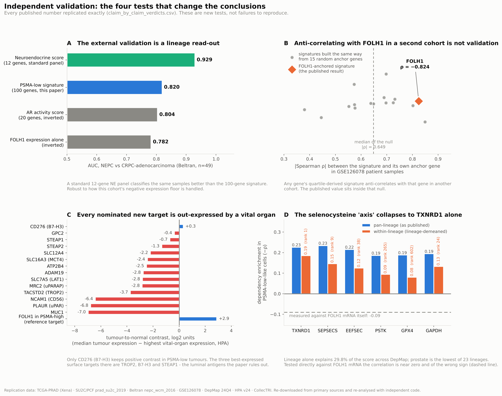
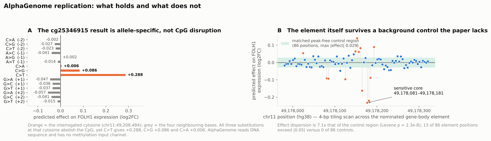
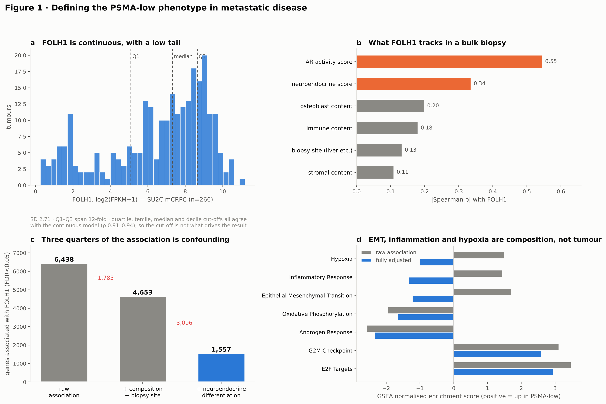
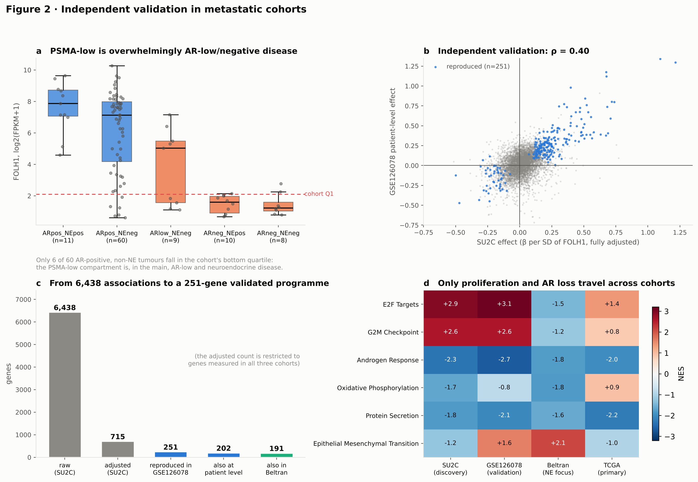
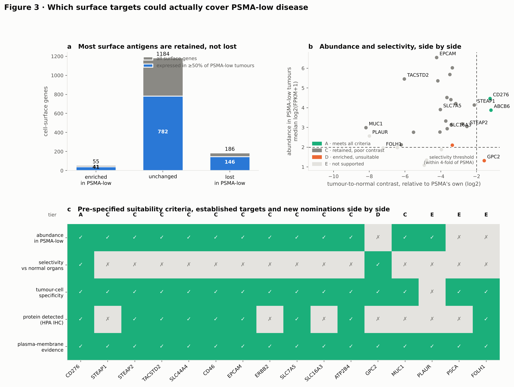
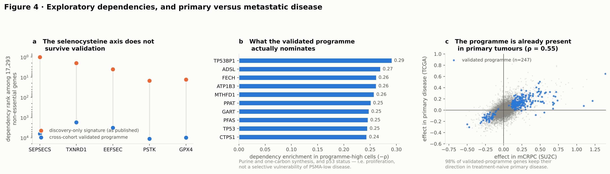

# PSMA / FOLH1 manuscript — independent replication and validation

Independent re-analysis of the manuscript *"An externally validated transcription-factor model of
PSMA (FOLH1) expression defines the PSMA-low state and nominates target-switching and
druggable-dependency strategies in metastatic prostate cancer"* (deliverable package v1.1),
prompted by the reviewer comments from Joe.

> This directory is a separate project from the lytic-peptide-actuator work in the repository
> root; it shares only the PI.

## Phase 1 (this directory) — done

Replication from primary data with independent code, then validation tests the manuscript does
not contain.

**Read first:** [`docs/phase1_replication_report.md`](docs/phase1_replication_report.md)

Headline: of 78 catalogued numerical claims — including the AlphaGenome analysis, re-run with the
PI's API key — 75 reproduce exactly and 1 does not (GSEA permutation p-values); the computational
work is sound. New validation tests nonetheless overturn the three headline conclusions, in the
direction Joe's review indicates.





## Phase 2 (this directory) — done

Re-analysis along the reviewer's five-step structure, a restructured manuscript, and a
point-by-point reply.

- [`docs/manuscript_v2.md`](docs/manuscript_v2.md) — the restructured paper
- [`docs/reply_to_joe.md`](docs/reply_to_joe.md) — point-by-point response

FOLH1 is modelled continuously with explicit adjustment for biopsy site, tumour composition and
neuroendocrine differentiation. Of 6,438 crude associations, 1,557 survive adjustment and 251
reproduce in an independent patient cohort. EMT, inflammation and hypoxia reverse sign on
adjustment. PSMA-low is overwhelmingly AR-low/neuroendocrine disease (6 of 60 AR-positive non-NE
metastases are PSMA-low). On the surfaceome, B7-H3 is the only antigen meeting all four
pre-specified suitability criteria; uPAR, LAT1, MCT4 and GPC2 each fail at least two. The TXNRD1
dependency does not survive validation.






## Layout

```
code/      the replication pipeline (s00-s08), runnable top to bottom
docs/      the Phase 1 report
results/   machine-readable outputs; claim_by_claim_verdicts.csv is the audit trail
figures/   summary figure (PNG + SVG)
```

## Reproducing

Data are re-downloaded from primary sources (TCGA/Xena, cBioPortal datahub, GEO, DepMap figshare,
HPA, UniProt, OmniPath/CollecTRI, Ensembl, ChIP-Atlas); `code/common.py` documents every URL and
file. Nothing from the authors' deliverable package is used as input.

```bash
python -m venv venv && ./venv/bin/pip install numpy scipy pandas scikit-learn statsmodels \
    lifelines decoupler pyreadr matplotlib
# place the downloaded cohorts in ./data, then:
PYTHONPATH=code python code/s00_meth_extract.py
PYTHONPATH=code python code/s01_landscape.py
...                                    # s02, s02b, s02c, s03 ... s08 in order
# phase 2:
PYTHONPATH=code python code/p2_01_discovery.py    # then p2_02, p2_02b, p2_03, p2_03b, p2_04, p2_05
# AlphaGenome stages need a key in a file OUTSIDE this repository:
ALPHAGENOME_KEY_FILE=/path/to/key PYTHONPATH=code python code/s09_alphagenome.py \
    landscape variants allele ism ism_control window determinism contact loci
```

`s02_tf_model.py` and `s02b_leakage_nulls.py` are the slow steps (nested cross-validation and the
random-regulon nulls); budget roughly an hour each on 4 cores.

## Note for the authors

A live `ALPHAGENOME_API_KEY` is hard-coded in the delivered notebook
(`execution_trace/psma_folh1_analysis.ipynb`, cell 41), which has already been circulated to
external collaborators. **Revoke and rotate it.** No key is stored in this repository — the
AlphaGenome stages read it from a file outside the repository tree.
